# Phạm Minh Trường · truongpm234

**Backend & Embedded C++ Developer · C# / .NET & C++** · Tập đoàn Đại Dũng - Dai Dung Corp · Vietnam (UTC+7)

[Email](mailto:phamminhtruong2032004@gmail.com) · [LinkedIn](https://www.linkedin.com/in/ph%E1%BA%A1m-minh-tr%C6%B0%E1%BB%9Dng-593085303) · [Facebook](https://www.facebook.com/mtrg234) · [GitHub](https://github.com/truongpm234)

 

<!-- AWAKEN:START -->
<!-- Generated by git-profile-awaken. Edit awaken.json instead of this block. -->

<picture><source media="(prefers-color-scheme: dark)" srcset="awaken/bento-dark.svg"><source media="(prefers-color-scheme: light)" srcset="awaken/bento-light.svg"></picture>

<!-- AWAKEN:END -->

Drawn every night by <a href="https://git-profile-awaken.vercel.app">Git Profile Awaken</a> · Auto-synced at 00:10 (UTC+7). Ranks are percentiles among regular GitHub players.

